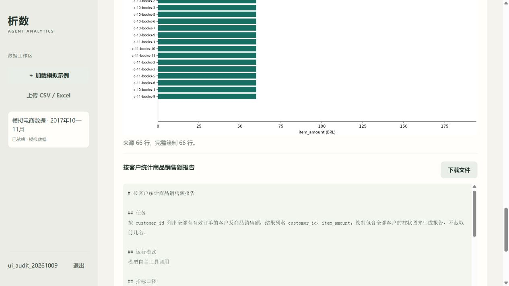

# 准确性、图表完整性与响应速度修复

日期：2026-10-09。对照基线：[修复前评测](evaluation-2026-10-09.md)。

## 结果

| 项目 | 修复前 | 修复后实际观察 |
| --- | --- | --- |
| 同一组主问题数值与指定工具交付 | 9/11 | 11/11 |
| 客户复购 | 33 位复购客户被错算为 0 | 33 位独立客户、33 位复购客户、100% |
| 有效状态 cancelled | 错查 delivered：66 单、6,550.00 商品金额 | 6 单、620.00 商品金额、72.00 运费 |
| 全部客户图表 | 表格 66 行，图只画 30 行 | 表格和图都包含全部 66 行 |
| 主题平均耗时 | 23.09 s | 15.92 s |
| 主题耗时中位数 | 20.46 s | 13.99 s，减少 31.6% |
| 主题 P95 | 46.38 s | 31.47 s |
| 相同规模整套 16 次任务 Token | 165,316 | 93,067，减少 43.7% |
| 两任务同时提交时次任务排队 | 10.15 s | 0.20 s |
| 全套回归测试 | 35 项 | 45 项通过，37.39 s |

同规模整套包括 11 道主问题、1 道规模统计、2 次重复题和 2 道同时提交任务。Token 对比没有混入额外边界或缺陷复测。供应商、模型、温度、思考开关、输出预算和模拟数据种子相同；执行部署从单 Worker 改成两个独立 Worker。

**11/11 只描述这轮固定模拟任务的数值、工具和文件交付，不代表任意问题总体准确率。** 人工审查还发现一条“数字正确、状态描述写反”的说明，已增加文字口径检查并单独复测通过。

边界补测三题均通过：自然问题、完整客户柱状图、零销售额分母。最新版本另外重跑 Python 占比、环比、客户复购和自定义状态四题，4/4 通过，并核查最终状态文字与实际计算一致。

## 修复内容

### 有效订单状态落实到实际执行

`metric_scope.scoped_query()` 根据 SQL 作用域识别物理 orders、order_items 数据源，将其换成绑定了任务有效状态的只读子查询。订单明细只能来自该状态下的订单；直接查明细、使用 CTE 或省略 WHERE 都不会绕过这项口径。

状态值使用 SQLAlchemy 参数绑定；用户和数据集范围仍由现有数据库 RLS 控制，没有放宽只读角色权限。显式写入冲突状态时返回具体错误，避免把冲突悄悄执行成空结果。

结果元数据保存原始 SQL、实际 SQL（effective_sql）、状态及执行约束。报告显示已确认状态和执行约束。分析说明若声称“排除”实际上包含的状态，或在非 delivered 数据集称“已交付”，会被拒绝并要求重写。

这使订单与商品明细分析遵守已确认的有效状态。当前分析不用于直接跨多个订单状态比较；此类需求需要另行设计显式授权的状态口径，不能将过滤去掉来兼容。

### 复购使用经过验证的专用计算

新增 customer_repeat_metrics 工具：先按 customer_unique_id 合并不同客户记录的有效订单，再计算独立客户、至少两单的复购客户和占比。支持开始日期包含、结束日期不包含的范围；未知独立客户标识的订单单独列示，不当作同一个客户。

复购报告必须包含该工具的实际产物，避免再次仅靠模型错误的聚合 SQL 完成报告。SQL、Python、图表等其他分析仍由模型选择。

测试改变一条跨月客户独立标识后，结果随真实数据变为 34 位独立客户、32 位复购客户、94.12%；仅十月为 33 位独立客户、零复购；cancelled 状态为 3 位独立客户、3 位复购。结果没有硬编码原示例的 33。

### 图表和报告完整覆盖

绘图取消 rows[:30]，完整绘制来源表格。超过十六行的柱状图使用横向布局并随行数增加高度，便于阅读；金额轴补充币种。产物登记 source_row_count、plotted_row_count、truncated 和方向，报告校验器核查行数相同且未截取。

单图超过 200 行明确拒绝，请求明确聚合或分组绘图；重复横轴维度也会提示聚合或分系列。没有把过多的行悄悄截成 Top N。

报告同样输出完整受限表格。已在真实 Matplotlib 调用中捕获 66 根柱子，并在真实模型端到端任务中核对 66 行表格、66 行图表和报告末尾记录。原始完整图片保存在边界评测目录。

前端表格仍使用预览，但明确显示“共 66 行，当前预览 20 行；CSV 和报告包含完整结果”。另通过浏览器真实模型任务验收了模型耗时事件、完整覆盖提示、刷新恢复和 CSV 下载：下载文件实际 66 行，金额合计 6,550.00；前端错误/警告日志为空。



### 交付完整性与文件引用

增加任务内 table_1、table_2 等稳定引用。Python 和单独绘图可以使用实际返回的 artifact_ref 或当前任务的真实 UUID；错误引用返回可用列表。不能凭短引用读取其他任务文件。

明确指定的列名必须同时出现在实际结果表中；明确要求 Python 时必须有真实沙箱产物，不能声明 SQL 等价就跳过要求。列名解析仅读取连续列表，不把后续“导出 CSV”“使用 Python”等说明误识别为字段。

这解决了中间修复阶段发现的两个问题：模型编造表格 ID，以及通过删除计算说明掩盖缺列。

### 减少模型轮次与无效重试

- 将数据字典、客户标识含义和当前口径提前提供给模型，减少额外 schema 请求。
- SQL 工具可以一次查询并顺序绘图；实际 SQL 和绘图事件仍分别记录，用户明确要求 Python 时保留真实 Python 调用。
- 鼓励 SQL 一次计算差值、环比、占比和客单价；未要求 Python 的简单计算减少额外沙箱轮次。
- 工具反馈保留结果、来源、稳定引用及覆盖信息，避免重复发送调用中已有的完整 SQL/代码。
- 数字校验允许结果表里的数值、合理展示精度及明确日期，不再因年份、月份反复拒绝；未执行的额外心算仍要求补充依据或删除。
- 错误反馈指明 title/notes 的字段和无依据数字；报告修正最多三次，不能耗尽全部 Agent 步数仍重复同一标题。
- 沙箱契约明确不允许 print，静态检查会在启动容器前给出反馈。

报告数字检查仍不能证明任意文本与数值字段一一对应，中文数字、隐含因果和复杂解释还需要进一步语义评测。核心状态和复购约束已由程序落实。

### 排队与性能观察

启动脚本默认启动两个独立 Windows solo Worker，并使用不同名称；仍可用 -Workers 1 运行一个 Worker。不同进程隔离事件循环和 Matplotlib，保留任务锁、数据集锁、checkpoint、晚确认及恢复机制。

脚本在 API、数据库和 Redis 就绪后输出工作台地址。每次模型请求现在记录耗时、HTTP 尝试次数和 Token，并逐轮保存已收到的 usage；前端显示“模型正在分析”和模型返回时间。两任务同时提交时实际开始时间接近，次任务不再等待首任务整体结束。

网络超时或供应商未返回 usage 时，无法知道那次请求的真实 Token。模型时间包含网络请求、有限重试和退避，不能把它等同于供应商内部推理时间。

## 验证证据与边界

完整回归 45/45，覆盖状态约束、同名 CTE、直接明细查询、变更后的客户标识、日期范围、其他账号隔离、真实 Python 沙箱、查询与绘图组合、任务短引用、缺列/Python 完成条件、重复校验终止、错误状态文字，以及图表 66 根实际柱数。所有 Python 函数的中文注释检查通过，前端 JS 语法检查通过。

真实模型证据：

- [同组完整复测](../../../evaluations/results/audit-final-20261009/results.json)：11/11 主题数值与交付，另有规模、重复及同时提交观察。
- [边界复测](../../../evaluations/results/edges-fixed-20261009/results.json)：3/3；图表元数据与完整来源表均为 66 行。
- [最新文字约束及缺陷复测](../../../evaluations/results/regression-final-20261009/results.json)：4/4，包含状态文字被拒绝后修正的事件和最终报告。
- [最终 cancelled 报告](../../../evaluations/results/regression-final-20261009/custom_valid_status/report.md)、[最终复购报告](../../../evaluations/results/regression-final-20261009/repeat_customer/report.md)。

保留了中间修复结果 audit-fixed-20261009，没有只留下最好的一次。中间轮出现表格引用和缺列问题后才加入相应约束。主复测后的人工文字检查又触发口径说明修复，没有把旧报告改写成新结果。

同组整体耗时与 Token 用量下降，但单题不会一致变快。品类 Python 题 33.78 → 36.03 秒、月度题 23.03 → 23.60 秒；主复测中的模型 HTTP 用时仍波动。更早的中间轮月度题达 75.28 秒。API 详情小样本 P95 为 184 ms，相比基线 159 ms，没有观察到该接口的加速。

因此本次可以确认减少冗余流程、修复已知错误、改善两任务排队，并观察到这轮总体响应变快；不能据此宣称长期 SLA、生产容量或所有问题都达到同样准确率。全量 Olist、长时间压力、大规模盲测及多机器部署仍未验证。

## 重跑

```powershell
conda activate langgraph
.\scripts\stop.ps1
python -m pytest -q
.\scripts\start.ps1 -Workers 2

python -m evaluations.benchmark --mode llm
python -m evaluations.edge_benchmark
python -m evaluations.regression
# 单独指定问题时：
python -m evaluations.regression --cases repeat_customer custom_valid_status
```

默认使用新的时间戳目录；指定输出目录已经存在时会拒绝覆盖。集成测试前停止 Worker/Beat，结束后再启动。模拟评测仍保存专用账号和证据，不保存账号密码、JWT 或模型 Key。
