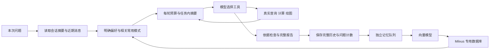

# 上下文管理与用户长期记忆

实现日期：2026-10-09。项目二的会话现在能够跨分析任务连续追问。新增功能不替代原来的 SQL 口径约束、来源检查和完整图表校验。

## 存储分工

| 位置 | 名称 | 用途 |
| --- | --- | --- |
| PostgreSQL `agent_analytics` | `analysis_conversations` | 会话归属、固定数据集、摘要、成功游标和摘要用量 |
| 同上 | `conversation_messages` | 用户问题及完整报告原文；独立受控视图用于构造上下文 |
| 同上 | `user_memories` | 明确偏好、版本、删除标记、同步状态 |
| 同上 | `user_question_patterns` | 问题模板、独立成功任务次数、版本和同步状态 |
| Milvus `agent_analytics_memory` | `user_memories` | 1024 维记忆向量、用户过滤字段、种类、版本与文本 |
| PostgreSQL checkpoint | 原有组件表 | 每个分析任务的完整消息、任务内摘要和执行进度 |

Milvus 专用数据库与原有 `default` 分开。新增集合使用显式字段、HNSW/COSINE 索引和 Strong 一致性。初始化只允许专用数据库；已有集合维度不兼容会报错，不会删除重建。`scripts/init_memory.py` 幂等初始化四表和集合，增量 DDL 位于 `migrations/002_memory_context.sql`。

## 两种个性化

1. **明确偏好**：前端设置默认柱状图/折线图，以及简洁/详细说明；也识别用户明确说“记住”“以后”“默认”的简单枚举要求。已保存偏好在其他会话仍生效。本次明确要求优先；偏好不能修改有效订单状态、金额定义或访问权限。简洁说明减少解释段落，完整计算表、图表及来源仍保留。
2. **常用问题模式**：只学习成功任务的用户问题，日期变为 `[时间范围]`，不保存旧分析答案。默认两次独立成功任务后成为常用模式；新问题使用嵌入和 Milvus 语义召回。页面提供常用模板按钮，用户补齐日期后提交；系统拒绝未填写的日期占位符。实际 SQL 和数值始终重新计算。

计数与任务已学习标记同事务提交，重复恢复不会重复计数。包含凭据关键词的问题不学习。前端“忘记”先将 PostgreSQL 权威记录软删除，立即停止使用，再异步删除向量。召回还会验证归属、版本、次数及删除标记，旧向量不能绕过删除。已忘记的相同模板不会被后续任务自动恢复。

明确偏好直接读取权威记录，避免语义相似度影响固定设置；它的向量副本仍存入 Milvus。问题模式通过 Milvus 匹配，最低相似度可配置。向量服务不可用时保留偏好与正常分析，并明确标记召回不可用。

## 两层上下文管理

**跨任务会话**：会话绑定用户和一个数据集，使用摘要加最近六条消息。旧报告保留完整原文，供模型读取的视图包含历史意图、字段和少量历史预览。旧消息通过当前聊天模型增量总结，成功才推进消息序号游标；失败保留原游标、显示错误，下一次继续重试。失败期间仅使用已有摘要与近期背景，可能遗漏较早细节。

**任务内工具循环**：每次决策之前估算输入、工具 schema、输出预留和协议余量。达到可用输入预算的 65% 时，总结旧消息，保留当前完整问题、系统约束、真实产物引用及近期工具链。assistant 调用与 tool 响应保持成对；完整原消息保留在 checkpoint。摘要失败后缩小近期视图以满足预算，游标不提前推进。当前问题与必要约束本身过长时返回明确错误，不静默截断问题。

摘要接口也执行输入预算检查，并分块处理较长材料。历史数值只作背景，不能作为新任务依据。任务内摘要用量记录在 `task.usage.context_summary` 与摘要事件中；跨任务摘要用量保存在会话 `summary_usage`。原有 `usage.total_tokens` 仍表示分析决策请求用量，不包含会话摘要和嵌入。



## 界面与接口

在工作台设置偏好，创建分析任务后可直接提交追问。“新会话”清除当前选择；“历史与摘要”显示完整原文、摘要和游标。切换数据集自动开始新会话。一个会话有运行、排队或待澄清任务时不能并行提交下一问，以保持明确顺序。

- `GET /api/memories`：自己的偏好、模板及索引状态。
- `PUT /api/memories/preferences`：更新明确提供的字段；null 删除。
- `GET /api/memories/suggestions?question=...`：相关常用模式；不填问题时按次数推荐模板。
- `DELETE /api/memories/{kind}/{id}`：忘记自己的记忆。
- `GET /api/conversations`：最近会话。
- `GET /api/conversations/{id}?after=0&limit=20`：原文分页、摘要及进度。
- `POST /api/analysis-tasks`：可传 `conversation_id` 延续同一数据集的会话。

异步索引使用独立 `analytics-memory` 队列和记忆 Worker，慢嵌入不阻塞分析 Worker 交付报告。Beat 每分钟重试 pending/failed，并补全成功任务的历史与学习。记忆工作可重复投递；已同步版本不会重复请求嵌入。

## 配置与验证

`.env` 分类 11～13 包含 Milvus、`BAAI/bge-m3`、召回阈值与摘要参数。向量密钥为空时复用聊天模型密钥。默认窗口 32000 是保守输入预算，不表示供应商官方窗口。更换模型时核对真实窗口与向量维度。

```powershell
python scripts/init_memory.py
python -m pytest -q
# 服务运行后做真实供应商端到端检查；结果保留在独立目录。
python -m evaluations.memory_context
```

普通测试使用真实 PostgreSQL、Milvus 和 Docker 沙箱，嵌入及摘要可控模拟；单独的端到端脚本使用真实模型与后台队列。测试覆盖摘要失败游标、预算、工具对、当前问题保留、计数幂等、版本过滤、用户隔离、删除与偏好覆盖。

## 当前边界

- Token 按 UTF-8 字节保守估算，不是供应商精确 tokenizer；错误窗口配置仍可能被模型拒绝。
- 摘要会丢细节；当前超长问题不会被自动裁短。必要时查看原文或重新说明条件。
- 常用模式计数使用规范化模板；同义改写不自动合并计数，语义召回可能漏匹配。
- 自然语言偏好识别是有限规则；复杂、否定或多个冲突要求建议通过前端明确设置。
- 简洁/详细目前影响模型说明要求和报告说明数量，属于基础展示个性化。
- 向量同步最终一致；页面可查看失败状态，Beat 会重试。当前不提供硬删除审计记录、数据过期策略或账号删除后的批量向量清理。
- 会话内只允许串行任务，避免并行分析互相改变追问背景。

## 本次验证与修复记录

- 全量回归：56 项通过。随后追加并验证列歧义诊断、原生 DATE_TRUNC 与工具协议纠正，相关 27 项测试通过；自然语言摘要及模型协议专项 14 项通过。新测试包含真实 PostgreSQL/Milvus/沙箱检查，供应商响应在常规测试中受控模拟。
- 真实供应商调用：`BAAI/bge-m3` 实际返回 1024 维向量。五轮真实模型、后台队列和专用 Milvus 数据库的取证结果分目录保存，保留失败轮次，未覆盖旧记录。
- 首轮发现终态发布早于会话报告保存：已改为先存原文、再发布成功，并在终态更新处检验历史已存在。
- 第二轮发现 PostgreSQL 列歧义仅反馈错误类型，导致模型重复错误 SQL：新增 SQLSTATE 42702 诊断，提示联表使用字段别名，并修正 sqlglot 对原生 DATE_TRUNC 的内部类型映射，权限范围不变。
- 历史背景下模型偶尔直接返回纯文字：增加最多三次协议尝试，未验证文字不进入报告或个性化记忆。成功纠正时累计所有已返回响应的 Token，用量没有漏掉纠正请求。
- 检查摘要内容后发现有一次输出仅复制 JSON：输入改为有标签的引用材料，要求中文自然语言；JSON/代码块包装判为失败，不推进游标。真实摘要补测已返回简短自然语言，并明确保留已交付图表状态。
- 浏览器已实际验证：偏好保存及重启保留、同一会话两次分析、常用模板填入、四条完整历史；浏览器错误日志为空。截图：`storage/traces/memory-context-ui.png`。

最终真实模型结果：`evaluations/results/memory-context-verified-20261009/results.json`，23/23 检查通过。五轮金额基准与图表类型均正确；会话保留十条原文，中文摘要成功推进到消息 2，摘要用量 617 Token。本轮五个任务耗时 7.88～19.60 秒，中位数 17.60 秒；工作量与上一轮性能评测不同，不能直接作为优化幅度。

独立任务内压缩实测：估算历史输入 16293 → 388 Token，可用预算 3635；完整原文仍在状态中，当前问题未裁剪，成功游标为 3。摘要接口耗时 5.06 秒，用量 2426 Token。估算输入与供应商计费 Token 含义不同，不应相减计算节省费用。

评测的预算数字为本项目估算值，固定模拟样本与少量调用不能推断整体准确率或服务 SLA。真实供应商存在单次三十多秒的响应波动，后台索引解耦不能消除聊天模型本身的延迟。
