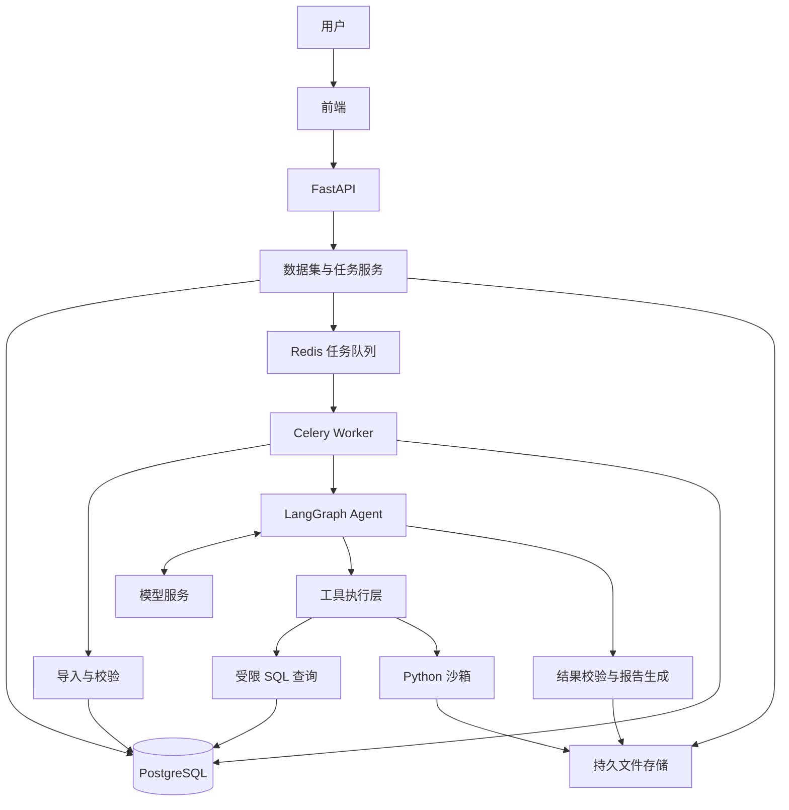
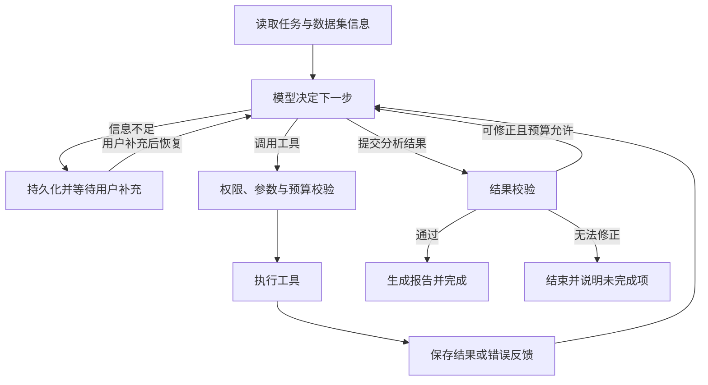

# 项目二：可验证的电商数据分析智能体

日期：2026-10-09  
文档状态：首版设计方案  
实现状态：已完成首版核心实现；本文保留原始设计目标。实际功能与边界见 [实现说明](../../../docs/02-项目架构与核心流程.md)，验证记录见 [验证记录](verification.md)。

## 1. 项目目标

用户选择示例数据，或上传符合模板的订单数据，通过自然语言提出分析需求。Agent 根据问题和中间结果自主选择 SQL、Python 与绘图工具，完成分析并生成可追溯的报告。

项目一展示书籍 RAG、引用、上下文管理和固定工作流；项目二重点展示自主工具调用、受限执行、错误恢复、任务持久化及数值评测。

目标用户是需要分析订单、商品和地区表现的运营人员。首版限定电商领域，支持规定结构的 CSV 与 XLSX 文件及字段映射。

### 1.1 示例任务

> 比较 2017 年 10 月与 11 月的有效订单商品金额，找出金额变化最大的三个品类，进一步按商品拆分，生成结果表、图表和报告。

用户最终获得：

- 指标定义、统计期间和筛选条件。
- 计算结果表与图表。
- 基于实际计算结果的分析文字。
- 支持追溯的 SQL、Python 脚本、数据版本和产物记录。
- 数据缺失、计算失败或证据不足的说明。

### 1.2 首版范围

| 纳入首版 | 后续扩展 |
| --- | --- |
| 内置 Olist 示例数据 | 连接外部业务数据库 |
| 四类业务表的 CSV/XLSX 导入 | 任意行业与复杂 Excel 布局 |
| 数据预览、字段映射与导入校验 | 自动适应未知业务口径 |
| 单 Agent 自主调用工具 | 有评测依据的多 Agent 协作 |
| SQL 查询、Python 分析、受控绘图 | 预测模型与复杂统计建模 |
| 人工澄清、中断恢复、取消任务 | 多 Worker 扩容与更复杂的调度 |
| Markdown 报告、CSV 结果、PNG 图表 | PDF/XLSX 等更多报告格式 |
| 固定任务集与故障评测 | 线上反馈与持续评测平台 |

## 2. 数据来源与输入

### 2.1 示例数据

采用 Olist 发布的匿名化电商公开数据，包含约 10 万笔 2016—2018 年订单。该数据是历史快照；示例问题使用其实际覆盖的时间段。

来源：[Brazilian E-Commerce Public Dataset by Olist](https://www.kaggle.com/datasets/olistbr/brazilian-ecommerce)。原页面标注许可证为 CC BY-NC-SA 4.0；发布示例数据包时保留来源与许可证信息。

首版使用：

| 原始文件 | 导入后的业务表 |
| --- | --- |
| `olist_orders_dataset.csv` | `orders` |
| `olist_order_items_dataset.csv` | `order_items` |
| `olist_products_dataset.csv` | `products` |
| `olist_customers_dataset.csv` | `customers` |

商品表中的原始品类名称可以直接用于分组；如需英文展示，可后续引入官方品类翻译文件。中文显示名需明确维护映射，不能由模型随意替换原始分类。

首版分析订单、商品金额、运费和配送表现。退款、利润及营销效果需要相应的退款、成本或流量数据，不能从这四张表推导出可靠结论。

### 2.2 用户上传

支持两种输入形式：四个对应模板的 CSV，或包含四个对应工作表的 XLSX。上传后先预览，再确认字段映射和口径，最后执行导入。

导入过程：

1. 保存原始文件及文件哈希，检查大小和文件类型。
2. 读取文件表头与预览行；CSV 支持 UTF-8/UTF-8 BOM，其他编码要求用户明确选择。
3. 用户确认工作表、字段映射、币种和时间解释。
4. 校验必填字段、类型、主键重复、关联缺失及金额格式。
5. 在事务中写入业务表，记录成功行数、错误信息和数据版本。
6. 完成后将数据集标为 `ready`，允许分析。

主键冲突和无法解析的必填字段导致导入失败并返回错误位置；允许为空的字段保留为空。不得静默删除异常行。大规模分批导入后续需要独立设计原子切换机制。

### 2.3 模拟评测数据

使用固定随机种子生成小型电商数据，记录生成脚本、参数和标准结果。

- 人为设置某个品类在指定月份下降，验证变化贡献分析。
- 加入重复记录、缺失字段和关联错误，验证导入校验。
- 设置上期金额为零、没有有效订单、多商品订单等边界。
- 模拟 SQL 超时、模型接口失败和 Worker 中断，验证恢复行为。

模拟数据单独标记，不能作为真实商业数据或真实业务收益展示。

## 3. 技术与总体架构

| 部分 | 首版方案 | 责任 |
| --- | --- | --- |
| 前端 | 沿用项目一已有技术方案 | 上传、对话、任务进度和结果展示 |
| API | FastAPI | 认证、资源归属、创建任务、状态接口和 SSE |
| 业务服务 | Python Service 层 | 数据集、指标口径及任务生命周期 |
| Agent | LangGraph | 模型决策、工具循环、澄清和状态持久化 |
| 后台任务 | Celery + Redis | 分发导入、分析及恢复任务 |
| 数据库 | PostgreSQL | 用户、数据集、业务数据、任务与 checkpoint |
| 分析工具 | SQL、Pandas、绘图库 | 数据查询、计算及图表生成 |
| Python 执行 | 受限容器 | 隔离代码执行，限制资源和文件访问 |
| 文件存储 | 本地持久目录 | 原文件、结果表、脚本、图表和报告 |
| 观测评测 | 结构化调用记录与固定任务集 | 定位问题、比较方案和统计效果 |

前端技术将在代码初始化时确定。首版不以新增前端框架作为项目目标。



API 接收请求后返回任务 ID；耗时操作由 Worker 执行。前端断开 SSE 不意味着任务取消。重新连接时先读取已保存的状态和步骤，再接收后续事件。

API 与 Worker 共用一个后端代码库。首版采用 Docker Compose 组织部署；PostgreSQL、Redis 和文件目录配置持久化。

## 4. 数据表设计

需要手工设计的核心应用表为六张：四张业务表，加 `datasets` 和 `analysis_tasks`。项目二独立部署时再创建 `users`，共七张。LangGraph checkpoint 及组件自行管理的表另计。

### 4.1 业务表

以下为规范化后的目标字段；与原始文件不同的字段名通过显式映射处理。

| 表 | 主要字段 | 主键 |
| --- | --- | --- |
| `customers` | `dataset_id`、`customer_id`、`customer_unique_id`、`city`、`state` | `(dataset_id, customer_id)` |
| `products` | `dataset_id`、`product_id`、`category_name`、可选商品属性 | `(dataset_id, product_id)` |
| `orders` | `dataset_id`、`order_id`、`customer_id`、`status`、`purchase_time`、配送相关时间 | `(dataset_id, order_id)` |
| `order_items` | `dataset_id`、`order_id`、`order_item_id`、`product_id`、`price`、`freight_value` | `(dataset_id, order_id, order_item_id)` |

关联约束：

- `orders(dataset_id, customer_id)` 关联 `customers`。
- `order_items(dataset_id, order_id)` 关联 `orders`。
- `order_items(dataset_id, product_id)` 关联 `products`。
- 四张业务表的 `dataset_id` 均关联 `datasets`。
- 所有跨表查询都包含数据集范围，避免不同数据集的同名 ID 混合。

Olist 的商品明细每行表示一个订单商品项，不存在可直接套用的通用 `quantity` 字段。首版按明细行金额求和；用户上传数量与单价时，必须单独确定映射和金额计算规则。

Olist 的 `customer_id` 与 `customer_unique_id` 含义不同。统计复购客户时使用后者，并明确观测窗口；首版可先不实现复购分析。

### 4.2 数据集表 `datasets`

建议字段：`id`、`user_id`、`name`、`source_type`、`status`、`data_version`、`file_manifest`、`field_mapping`、`schema_description`、`metric_definitions`、`import_summary`、`error_info`、创建及更新时间。

文件清单、映射和口径可使用 JSONB 保存。文件清单记录原始文件名、服务端存储键、哈希和大小。首版每次导入创建新数据集，已就绪数据集作为不可变快照；修正数据通过新数据集导入。

状态：`uploaded → importing → ready`，导入失败转为 `failed`。只有 `ready` 数据集可创建分析任务。

### 4.3 分析任务表 `analysis_tasks`

建议字段：`id`、`user_id`、`dataset_id`、`question`、`status`、`thread_id`、`model_profile_ref`、`model_config_snapshot`、`data_version`、`metric_snapshot`、`resume_payload`、`execution_record_key`、`artifact_manifest`、`usage_summary`、`error_info`、运行与更新时间。

模型快照记录模型标识和生成参数，不记录明文 Key。报告、脚本及结果文件保存为服务端存储键。执行轨迹使用持久化的追加式 JSONL 文件；若后续需要高并发检索或审计，再增加专门的事件表。

状态：`queued`、`running`、`waiting_input`、`succeeded`、`failed`、`cancelled`。

### 4.4 指标口径

| 指标或规则 | 首版定义 |
| --- | --- |
| 统计期间 | 按 `purchase_time` 筛选，采用起点包含、终点不包含的区间 |
| 有效订单 | 当前快照中状态为 `delivered` 的订单 |
| 商品金额 | 有效订单明细的 `price` 之和，不包含运费 |
| 订单量 | 有效订单 ID 的去重数量 |
| 平均每单商品金额 | 商品金额 / 有效订单量；分母为零时返回无定义并解释 |
| 环比变化率 | `(本期 - 上期) / 上期`；上期为零时返回无定义并单独说明 |
| 币种 | Olist 示例使用 BRL；其他上传数据需确认 |
| 配送时长 | 实际送达时间减购买时间；仅统计时间有效的已送达订单 |

商品金额采用数据库定点数处理。Python 中避免未经说明的浮点金额累计；报告统一声明显示精度。原始时间没有时区时，按数据说明处理，不能擅自假设 UTC。两个期间需检查是否完整可比。

关联商品明细后，订单会出现多行，不能直接用行数作为订单量。首版采用这些口径作为约定，不把商品金额称为平台营业收入或利润。

## 5. Agent 状态与执行流程

状态包括：用户问题、数据集和口径快照、近期消息、简要计划、已完成步骤、工具结果引用、错误摘要、待澄清问题、剩余预算及最终产物。



任务启动时由确定性节点加载基础信息；模型根据任务决定后续查询和分析步骤。设置可配置的最大步骤数、每类工具修正次数、总时限和 Token 预算，禁止无限循环。

错误处理区分接口暂时失败、SQL 语法错误、查询超时、权限拒绝、空结果及数据缺失。暂时性接口故障采用有限重试；SQL 错误反馈模型修正；权限拒绝与数据不存在不能通过重复重试解决。

报告只支持有计算依据的结论。变化贡献是数值分解，不自动等于业务因果；没有营销、流量等数据时，原因解释标记为待验证假设。

## 6. 工具设计与执行边界

| 工具 | 作用 | 返回内容 |
| --- | --- | --- |
| `get_dataset_schema` | 查询当前数据集结构及关联 | 表、列、类型、含义和少量样例 |
| `get_metric_definitions` | 查询当前任务的指标口径 | 时间、状态、金额和单位规则 |
| `execute_sql` | 执行经过限制的 SQL | 列名、行数、摘要、SQL 记录及结果文件 ID |
| `run_python` | 对指定结果文件执行分析 | 输出摘要、脚本记录、结果文件 ID |
| `render_chart` | 按经校验的图表参数绘图 | 图表文件 ID 和对应数据文件 ID |

`dataset_id`、用户身份和可访问产物由服务端注入并验证，不依赖模型选择。工具参数使用结构化 schema 校验。大结果保存为文件，模型只接收必要摘要和受限样例。

SQL 执行层使用只读数据库角色、语法解析检查、允许的表与函数范围、超时及结果大小限制。数据集隔离通过数据库行级策略或受控查询视图等机制落实；具体实现须在代码阶段选择并测试，不能仅依靠模型生成 `WHERE dataset_id = ...`。

Python 使用非特权受限容器，仅挂载授权结果文件的只读目录及独立输出目录，不注入数据库凭据和模型 Key。默认关闭网络，限制 CPU、内存、进程和运行时长，不挂载宿主机 Docker socket。对文件路径与产物归属进行服务端校验。

数据库文本、商品名称和上传文件内容属于分析数据，不作为工具权限或系统指令来源。生成代码的静态检查作为额外约束；执行隔离由容器和宿主配置落实。

## 7. 后台任务、恢复与事件

### 7.1 调度职责

- PostgreSQL 保存应用任务的权威状态。
- Celery 与 Redis 负责投递和执行。
- LangGraph checkpoint 保存 Agent 的执行状态。
- 应用负责将失败后的重新投递与 checkpoint 恢复连接起来。

创建数据库任务与发送队列消息之间存在失败窗口。首版可定期检查长时间未启动的 `queued` 任务并补投；补投可能重复，Worker 需按任务 ID 原子领取并校验状态。更复杂的可靠投递可以后续采用 outbox 表。

Celery 消息确认、重试、Redis 持久化和长任务可见性配置需要结合任务时限测试。不能把默认队列配置当成任务必定恢复或恰好执行一次的保证。

### 7.2 恢复与幂等

- 同一 `thread_id` 同时只允许一个执行者，需有运行锁或租约；失效执行者的更新应被拒绝。
- 工具产物按任务、逻辑步骤与尝试编号登记，写入临时文件后原子发布。
- 已完成工具结果优先从持久记录恢复，避免重复计算和重复生成报告。
- 遇到人工澄清时保存 checkpoint，标为 `waiting_input` 并释放 Worker。
- 用户补充输入后重新投递恢复任务；恢复可能重新执行节点代码，因此节点副作用必须幂等。
- 取消标志在步骤边界及执行器中检查；运行中的 SQL/Python 要支持超时或终止。
- Worker 崩溃后识别失效运行，按恢复规则继续或标记失败，保留错误原因。

### 7.3 前端事件

事件包含任务 ID、顺序号、时间、类型和有效载荷，例如任务启动、工具启动、工具完成、等待输入、报告就绪、失败与取消。

先保存事件再通知客户端。SSE 重连按顺序号补读已保存事件；首版单 Worker 通过持久记录实现，后续并发扩展时考虑专门的事件存储。展示步骤摘要、工具参数、结果和错误，不要求模型暴露完整内部推理。

## 8. API 草案

以下是待实现的接口约定，具体请求 schema 在编码阶段补充。

| 方法 | 路径 | 用途 |
| --- | --- | --- |
| POST | `/api/datasets` | 创建数据集并上传文件 |
| GET | `/api/datasets` | 当前用户的数据集列表 |
| GET | `/api/datasets/{id}/preview` | 文件、工作表和字段预览 |
| POST | `/api/datasets/{id}/import` | 提交映射和口径，启动导入 |
| GET | `/api/datasets/{id}` | 状态、结构及导入结果 |
| POST | `/api/analysis-tasks` | 创建分析任务 |
| GET | `/api/analysis-tasks/{id}` | 查询状态和结果 |
| GET | `/api/analysis-tasks/{id}/events` | SSE 事件流，支持历史补读 |
| POST | `/api/analysis-tasks/{id}/resume` | 提交澄清内容并恢复 |
| POST | `/api/analysis-tasks/{id}/cancel` | 请求取消 |
| GET | `/api/artifacts/{id}` | 经归属校验后下载产物 |

所有资源接口检查用户归属。下载接口使用产物 ID 查找受控存储位置，不接受任意服务器文件路径。

## 9. 结果校验与评测

### 9.1 运行时校验

报告使用带来源标识的结果结构。检查关键数字、单位和筛选范围是否一致，图表是否对应指定结果表，总额与分项是否在可解释的精度内一致。统计行数、缺失值和时间范围，发现异常时返回修正或说明。

这些检查不能证明任意分析语义都正确；业务语义与复杂分析效果通过标准任务评测及人工检查补充。

### 9.2 首批评测任务

建立 30—50 个任务，从开发起步时即定义成功条件，并分开维护开发集和保留测试集。

| 类型 | 内容 |
| --- | --- |
| 基础计算 | 汇总、排序、订单去重、分组 |
| 多表分析 | 商品品类、客户地区、正确关联粒度 |
| 多步骤任务 | 月度比较、变化贡献、商品拆分、绘图 |
| 边界情况 | 零分母、空结果、缺失字段、不完整期间 |
| 权限与约束 | 跨数据集查询、越权产物、超时和超预算 |
| 故障恢复 | 工具错误、模型暂时失败、Worker 崩溃、SSE 断线 |

核心指标：数值正确率、完整任务完成率、故障恢复率、约束遵守情况，以及耗时、Token、工具调用次数和费用。

对比一次生成 SQL 的基线方案与带反馈、有限修正及结果校验的 Agent 方案。固定数据版本、口径和模型参数，对有随机性的任务重复运行，记录失败样例。SQL 文本不要求完全相同，重点比较执行结果与业务语义。

费用优先使用模型服务返回的 usage 及明确的价格版本计算；缺少计费数据时标注估算或不可用。尚无实测结果时，不在简历中填写成功率、提升幅度或成本收益。

## 10. 目录结构

```text
agent-project/
├── docs/
│   └── project-02-design.md
├── backend/                         # 以下目录待创建
│   ├── api/
│   ├── services/
│   ├── repositories/
│   ├── models/
│   ├── ingestion/
│   ├── agent/
│   │   ├── state.py
│   │   ├── graph.py
│   │   ├── nodes/
│   │   └── prompts/
│   ├── tools/
│   ├── execution/
│   ├── reporting/
│   └── workers/
├── frontend/
├── migrations/
├── tests/
├── evaluations/
├── scripts/
├── sandbox/
└── compose.yaml
```

原始数据、运行产物、凭据和本地环境文件不纳入代码提交；示例数据获取脚本和模拟数据生成脚本可以纳入。

## 11. 开发顺序与验收

| 阶段 | 工作 | 验收 |
| --- | --- | --- |
| 1. 数据基础 | 数据迁移、Olist 导入、固定指标查询、小型标准数据 | 四表关联正确，基础结果与标准 SQL 一致 |
| 2. 最小 Agent | 模型接入、SQL 工具循环、预算和错误反馈 | 能完成基础任务，错误有限修正，越权查询被执行层拒绝 |
| 3. 分析产物 | Python 沙箱、图表和带依据报告 | 关键数字和图表可追溯，沙箱限制可验证 |
| 4. 应用流程 | 数据集与任务页面、上传映射、SSE、澄清与取消 | 用户能够独立完成导入和分析流程 |
| 5. 恢复评测 | Worker 重启、重复投递、断线恢复、固定任务集和对比 | 保留复现步骤、测试报告、失败样例和效果边界 |

演示至少包括一次正常分析、一次工具错误修正、一次澄清后恢复和一次数据不足的合理结束。展示数据、任务轨迹和报告之间的关联。

## 12. 架构参考

- [LangGraph overview](https://docs.langchain.com/oss/python/langgraph/overview)：编排、状态、持久化与人工介入。
- [LangChain SQL Agent 教程](https://docs.langchain.com/oss/python/langchain/sql-agent)：SQL 工具反馈循环；示例工具需要额外的生产约束。
- [LangGraph interrupts](https://docs.langchain.com/oss/python/langgraph/interrupts)：暂停、补充输入及节点恢复语义。
- [Dify 官方项目](https://github.com/langgenius/dify) 与 [部署配置](https://github.com/langgenius/dify/blob/main/docker/docker-compose.yaml)：应用组件拆分参考。
- [Celery task 文档](https://docs.celeryq.dev/en/stable/userguide/tasks.html)：消息确认、重试和幂等。
- [Temporal Agent 参考架构](https://go.temporal.io/platform-hub/ai-engineering/ai-reference-architecture)：长任务持久化执行的后续参考，首版不引入。
- [美团 Agent 评测实践](https://tech.meituan.com/2026/08/07/Agent-Evaluation.html)：结果、过程、效率与风险评测。

上述是设计参考，不代表本项目已实现同等能力。框架版本在代码初始化时核对并锁定。
